✦ ───────────────────────────── ✦

## About me

I'm a final-year **B.E. Computer Science** student (Class of 2027) at **Prince Shri Venkateshwara Padmavathy Engineering College, Chennai**.

I like building useful, well-structured things, from **AI-powered backends** to **clean interfaces** and **game worlds**. My background spans software development, UI/UX design and game development.

- 🤖 Currently building **SafeShift**, a source-grounded AI safety assistant (FastAPI + Gemini)
- 🎯 Looking for **Associate Software Engineer / fresher** roles
- 🎮 Also into game development with Unreal Engine and Unity
- 🧠 Strengthening core CS fundamentals, Java, databases and cloud basics

✦ ───────────────────────────── ✦

## The tools behind the work

<picture>
  <source media="(prefers-color-scheme: light)" srcset="https://www.gitskins.com/api/section/stack?username=haresh-web-code&theme=github-dark&avatar=https%3A%2F%2Favatars.githubusercontent.com%2Fu%2F222404349%3Fs%3D460%26v%3D4&variant=wow&v=wow-stack-1&mode=light" />
  
</picture>

✦ ───────────────────────────── ✦

## Featured projects

<table width="100%">
<tr>
<td width="50%" valign="top">

**🦺 [SafeShift](https://github.com/Haresh-web-code/SafeShift)**

Workplace-safety assistant for factory supervisors. Answers questions from OSHA publications (116 PDF pages) with document and page citations, and flags what the sources can't answer. Streaming API, Docker, CI and 27 automated tests.

Python · FastAPI · Gemini · Docker · Pytest

</td>
<td width="50%" valign="top">

**🌐 [Haresh-portfolio](https://github.com/Haresh-web-code/Haresh-portfolio)**

Personal portfolio website presenting my projects, skills and design work.

HTML · CSS

**🔴 [Pokedex](https://github.com/Haresh-web-code/Pokedex)**

Pokédex-style front-end project focused on layout and CSS.

HTML · CSS

</td>
</tr>
</table>

**Other builds:** 🚗 IoT-based anti-theft vehicle system · 👁️ Tactile-Vision, an accessibility tool for visually impaired users · 💬 College Admin FAQ Bot

✦ ───────────────────────────── ✦

## Certifications

Click any card to open the original certificate.

✦ ───────────────────────────── ✦

## Let's build something useful together

I like working with people who care about craft, context and shipping the useful version.

